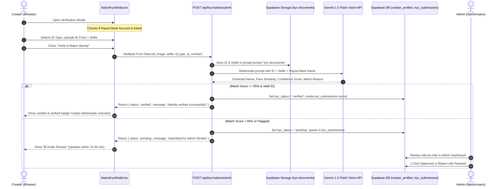

# Design Specification: Native In-House Identity Verification (KYC)

**Date:** 2026-11-02  
**Status:** Draft / Pending User Review  
**Target Delivery:** Kpugi Creator Platform  

---

## 1. Executive Summary & Objective

Kpugi is replacing external third-party identity verification vendors (Didit) with a **100% in-house, zero-cost, fully-controlled identity verification system**. 

### The Problem with 3rd-Party Vendors (Didit, etc.)
1. **Volatile Pricing & Rug-Pulls:** Didit abruptly terminated their 500 free checks/month model on November 1, 2026, forcing a $10 credit cap (~30 checks) and blocking API sessions with `400 Bad Request: You don't have enough credits`.
2. **Broken Redirects & User Drop-off:** Failed session creation generated broken fallback URLs (`verify.didit.me/session/...`) showing "Page not found" to creators, trapping accounts in limbo.
3. **The "Bank Account" Blindspot:** Third-party KYC providers only verify that an ID belongs to a face. They do **not** verify whether the ID matches the creator's payout bank account (`account_name`, e.g., `NABOM TUAZOR CLARK` from Paystack). 
4. **Poor Nigerian Document Support:** International OCR models frequently reject Nigerian National Identification Number (NIN) paper slips and temporary voter cards.

### The In-House Solution
A native, beautiful 4-step modal built directly into Kpugi Settings:
1. Creator uploads front of their official ID (NIN Slip/Card, Voter's Card, Driver's License, International Passport) + a live selfie.
2. An instant multimodal AI Vision engine (Gemini 1.5 Flash via `GOOGLE_GENERATIVE_AI_API_KEY`, 1,500 free requests/day) extracts the legal name, checks face presence, and cross-checks against the creator's **Payout Bank Account Name**.
3. **Hybrid Decision:**
   - **Auto-Approval:** If legal name matches payout bank name ($\ge 85\%$ token match) and document is valid $\rightarrow$ **Instant Approval** in under 3 seconds!
   - **Admin Review Queue:** If name has a minor discrepancy (e.g. maiden name, missing middle name, or blurry photo) $\rightarrow$ automatically queued for **1-click Admin Review** in `/admin/users`.
4. **Zero Vendor Fees Forever:** No per-check fees, no surprise rate hikes, no external redirects.

---

## 2. Architecture & System Flow



---

## 3. Detailed Component & UI/UX Design

### 3.1 Prerequisite Check (Bank Account First)
Identity verification is designed to prevent payout fraud. Therefore, the creator must have a linked Payout Bank Account before starting verification:
- In `CreatorSettingsView.tsx`: If `creator.primaryBank` is null or missing:
  - The **Verify Identity 🛡️** button shows a friendly guidance tooltip:
    > *"Please link your Nigerian Payout Bank Account first so we can verify your legal name."*
  - Clicking it smoothly scrolls the page up to the **Payout Bank Account** card.

### 3.2 Creator Settings Verification Card States
Located in `components/creator/settings/CreatorSettingsView.tsx`:

1. **State: `unverified`**
   - Badge: `Required` (Indigo badge)
   - Text: *"Verify your official government ID (NIN, Voter Card, or Passport) to enable instant earnings withdrawals."*
   - CTA: `Verify Identity 🛡️` (Opens `NativeKycModal`)

2. **State: `pending` (Under Review)**
   - Badge: `⏳ Under Review` (Amber badge, pulsing)
   - Text: *"Your verification submission is being checked. Most submissions are processed within 15–30 minutes."*
   - Subtext: Displays submitted document type and date.
   - CTA: Secondary subtle link: *"Need to update your submission? Re-upload documents"*.

3. **State: `verified`**
   - Badge: `✓ Verified` (Emerald badge)
   - Text: *"Official Government ID Verified. Instant earnings payouts enabled."*
   - CTA: Disabled green button: `Identity Verified ✓`.

4. **State: `rejected`**
   - Badge: `✕ Action Required` (Rose badge)
   - Text: Displays the exact rejection reason (e.g. *"Name on ID does not match your bank account name NABOM TUAZOR CLARK"*).
   - CTA: `Re-submit Identity Verification 🔄`.

### 3.3 The Native Verification Modal (`NativeKycModal.tsx`)
A clean, accessible, mobile-optimized modal:
- **Header:** 
  - Title: *"Verify Your Identity"*
  - Subtitle: *"Fast, secure 1-minute verification to unlock earnings payouts."*
  - Matching context pill: *"Payout Account: {account_name} ({bank_name})"*
- **Step 1: Document Details:**
  - Document Type Selector:
    - National Identity Number (NIN Slip or Plastic Card)
    - Permanent Voter's Card (PVC)
    - Driver's License
    - International Passport
  - Document Number (Optional/Recommended): e.g. 11-digit NIN or Passport Number.
- **Step 2: ID Document Upload (Front):**
  - Drag-and-drop zone with camera icon.
  - Supports direct camera snap on mobile (`capture="environment"`).
  - Live thumbnail preview with 1-click replace or remove.
  - Tips list: *"Ensure all 4 corners are visible • Avoid glare and shadows • Text must be readable"*.
- **Step 3: Live Selfie Photo:**
  - Front camera capture or selfie upload (`capture="user"`).
  - Clear oval guideline framing: *"Take a clear selfie in good lighting without hats or sunglasses"*.
  - Live thumbnail preview.
- **Step 4: Submission & Processing Animation:**
  - Button: **"Verify & Match Identity 🛡️"**
  - While processing: Button enters loading state with animated progress text:
    - *"Uploading encrypted documents..."* $\rightarrow$
    - *"Analyzing document & biometrics..."* $\rightarrow$
    - *"Cross-referencing with {account_name}..."*
- **Outcome Screens:**
  - **Success:** Full confetti animation (`canvas-confetti`), green checkmark, *"Identity Verified! Your instant earnings withdrawals are now fully unlocked."* (Modal closes after 2 seconds, card updates).
  - **Review Queued:** Amber shield, *"Submission Received! We are doing a quick manual check of your details. Your dashboard will update shortly."*

---

## 4. Backend Engine & Matching Logic

### 4.1 Supabase Storage Setup
- Bucket: `kyc-documents`
- Public Access: `false` (Private bucket).
- Path Convention:
  - `${creatorId}/id_front_${Date.now()}.${ext}`
  - `${creatorId}/selfie_${Date.now()}.${ext}`
- Security: Files cannot be fetched without Supabase Service Role or short-lived Signed URLs ($< 15$ minutes expiry).

### 4.2 Database Schema: `kyc_submissions`
A new table in Supabase to track all verification records:

```sql
CREATE TABLE IF NOT EXISTS public.kyc_submissions (
    id UUID PRIMARY KEY DEFAULT gen_random_uuid(),
    creator_id UUID NOT NULL REFERENCES public.creator_profiles(profile_id) ON DELETE CASCADE,
    document_type TEXT NOT NULL, -- 'nin_slip', 'nin_card', 'voters_card', 'drivers_license', 'passport'
    id_number TEXT,
    id_front_path TEXT NOT NULL,
    selfie_path TEXT NOT NULL,
    bank_account_name TEXT NOT NULL,
    ai_extracted_name TEXT,
    ai_confidence_score NUMERIC(5,2),
    ai_match_score NUMERIC(5,2),
    ai_reason TEXT,
    ai_raw_response JSONB,
    decision TEXT NOT NULL DEFAULT 'pending', -- 'auto_approved', 'pending_admin', 'admin_approved', 'admin_rejected'
    rejection_reason TEXT,
    reviewed_by UUID REFERENCES auth.users(id),
    reviewed_at TIMESTAMPTZ,
    created_at TIMESTAMPTZ NOT NULL DEFAULT NOW(),
    updated_at TIMESTAMPTZ NOT NULL DEFAULT NOW()
);

-- Index for speedy queries by creator and admin review status
CREATE INDEX IF NOT EXISTS idx_kyc_submissions_creator ON public.kyc_submissions(creator_id);
CREATE INDEX IF NOT EXISTS idx_kyc_submissions_decision ON public.kyc_submissions(decision);
```

### 4.3 Multimodal Gemini 1.5 Flash Vision Prompt
We call Google Gemini 1.5 Flash via the existing `@google/genai` or direct REST API using `process.env.GOOGLE_GENERATIVE_AI_API_KEY`:

```json
{
  "systemInstruction": "You are a specialized identity verification compliance agent for Kpugi. You evaluate uploaded government identity documents and selfies against registered payout bank account names.",
  "prompt": "Evaluate Image 1 (Government ID) and Image 2 (Selfie photo) against the Creator's registered Payout Bank Account Name: '{{bank_account_name}}'.
  
  Perform these tasks:
  1. Determine if Image 1 is a valid government-issued ID (NIN, Voter Card, Driver's License, or Passport).
  2. Extract the full legal name printed on Image 1.
  3. Determine if the person in Image 2 (Selfie) matches the face shown on Image 1 (ID photo).
  4. Compare the extracted name against '{{bank_account_name}}'. Note: In Nigerian banking, name order often varies (e.g., 'SURNAME FIRSTNAME MIDDLENAME' vs 'FIRSTNAME SURNAME'). Account for permutations, common spelling variations, or title prefixes (Mr/Mrs).
  5. Compute a name_match_score between 0 and 100.
  6. Compute a face_match_score between 0 and 100.
  7. Return strict JSON following the schema."
}
```

Expected JSON Output from Gemini:
```json
{
  "is_valid_id": true,
  "id_type_detected": "nin_slip",
  "extracted_name": "NABOM TUAZOR CLARK",
  "name_match_score": 100,
  "face_match_score": 92,
  "is_face_matched": true,
  "is_recommended_approval": true,
  "confidence_score": 95,
  "summary_reason": "Full legal name matches payout bank account exactly. Selfie biometrics match ID portrait."
}
```

### 4.4 Deterministic Name Matching Algorithm
To avoid AI hallucinations and ensure safety:
1. Normalize both strings: uppercase, remove punctuation, strip common prefixes (`MR`, `MRS`, `DR`, `CHIEF`).
2. Tokenize into distinct name words:
   - Target tokens: `["NABOM", "TUAZOR", "CLARK"]`
   - Extracted tokens: `["CLARK", "NABOM", "TUAZOR"]`
3. Check set intersection:
   - If all significant tokens match regardless of order $\rightarrow$ **100% Match**.
   - If 2 out of 3 match (e.g. middle name omitted in bank or ID) $\rightarrow$ **85% Match** $\rightarrow$ **Auto-Approved**.
   - If only 1 name matches or entirely different names $\rightarrow$ **Flagged for Admin Review**.

---

## 5. Admin Review Dashboard (`/admin/users`)

In `components/admin/users/`:
1. Add a **"Pending KYC Submissions"** review filter / tab.
2. In the Creator Detail Drawer (`UserDetailAdminView.tsx`):
   - Add a dedicated **Identity Verification** section.
   - Side-by-side modal displaying:
     - **ID Front Document** (fetched via signed URL)
     - **Selfie Photo** (fetched via signed URL)
     - **Bank Account Payout Name:** `NABOM TUAZOR CLARK`
     - **AI Extracted Name:** `NABOM TUAZOR CLARK`
     - **AI Summary & Scores:** (Name Match: 100%, Face Match: 92%)
   - Action Buttons:
     - **[Approve Verification]** (Green) $\rightarrow$ updates `creator_profiles.kyc_status = 'verified'`, sets `kyc_verified_at = now()`, marks submission `admin_approved`.
     - **[Reject Verification]** (Red) $\rightarrow$ opens prompt to select reason (e.g., *"Document expired"*, *"Photo blurry"*, *"Name on ID does not match payout bank account"*), resets `creator_profiles.kyc_status = 'rejected'`, saves `kyc_rejection_reason`.

---

## 6. Migration & Deprecation of Didit

1. **Delete Dead Code / Routes:**
   - Remove Didit API calls in `lib/didit/client.ts` or replace with native verification exports.
   - Update `app/api/kyc/didit/session/route.ts` $\rightarrow$ replace with `app/api/kyc/native/submit/route.ts`.
   - Safely archive `app/api/webhooks/didit/route.ts`.
2. **Database Clean-up:**
   - Deprecate `kyc_didit_session_id` in `creator_profiles` (retained in schema as nullable for backwards compatibility).
   - Ensure all existing creators with `kyc_status: 'verified'` remain verified.

---

## 7. Verification & Testing Plan

1. **Happy Path - Auto-Approval:**
   - Submit clear Nigerian ID where name matches bank account.
   - Verify Gemini extracts name accurately, token matcher scores $\ge 85\%$.
   - Verify creator profile transitions to `'verified'` and payouts unlock immediately without admin intervention.
2. **Edge Case - Name Permutation:**
   - Bank name: `CLARK NABOM TUAZOR`
   - ID name: `NABOM TUAZOR CLARK`
   - Verify system detects token equality and auto-approves.
3. **Edge Case - Discrepancy / Blurry Photo:**
   - Submit photo where name has partial match (e.g., maiden name) or blurry selfie.
   - Verify status transitions to `'pending'` and appears in `/admin/users` review queue.
   - Verify Admin 1-click **[Approve]** and **[Reject]** successfully update creator state.
4. **Security & Storage Protection:**
   - Verify unauthenticated requests cannot access files in `kyc-documents` bucket.
   - Verify non-admin users cannot approve submissions.
